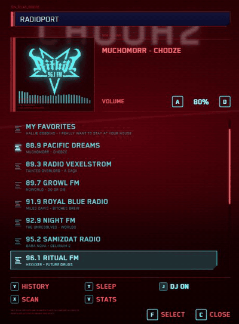
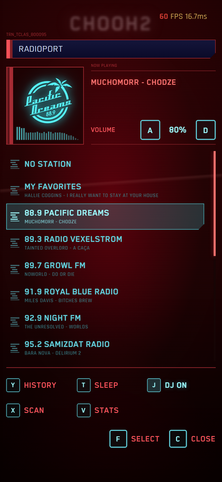
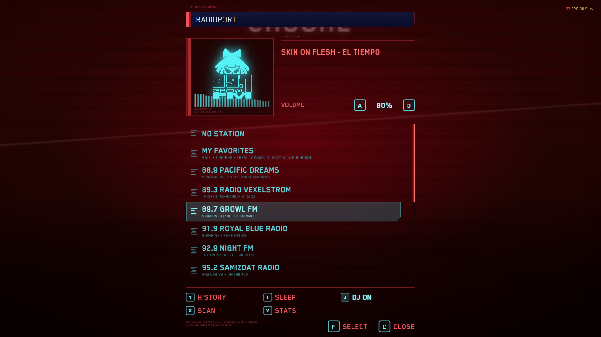

# Radioport

<p align="center">
  
  &nbsp;
  
</p>

<p align="center">
  
</p>

> **EN:** An unofficial, fan-made web player that recreates the RADIOPORT screen from *Cyberpunk 2077*
> (14 stations, live-schedule playback, DJ voice lines, stats, phone and gamepad support).
> This repository contains **code and extraction scripts only**. No game music, voices, logo files or fonts are included
> or linked (the screenshots above only show the interface). You rebuild them yourself from **your own legally purchased copy** of the game with `pipeline/`
> (see [Сборка ассетов](#сборка-ассетов-из-игры) and [docs/PIPELINE.md](docs/PIPELINE.md)).
> Not affiliated with or endorsed by CD PROJEKT RED. *Cyberpunk 2077* is a trademark of CD PROJEKT S.A.
> Code is MIT-licensed; game assets belong to their owners. Do not publish the built site.
> Requires Python 3, ffmpeg, WolvenKit CLI, vgmstream-cli.

Личный веб-плеер в стиле экрана **RADIOPORT** из Cyberpunk 2077: 14 станций, «живой эфир», диджеи, статистика.
Музыка и интерфейс берутся из **твоей собственной копии игры**. В репозитории нет игровой музыки, голосов, графики и шрифтов,
только код и скрипты, которые достают всё это из установленной игры.

> **Только для личного использования.** Репозиторий содержит код и скрипты. Музыка, голоса, логотипы и шрифты
> принадлежат их правообладателям (CD PROJEKT RED и артистам). Не выкладывай собранный сайт в открытый доступ.
> Закрой его входом (см. [Хостинг дома](#хостинг-дома)).

## Что умеет

- **Живое радио.** Каждая станция играет по кругу по детерминированному расписанию: переключился на станцию и попал в «текущее» место эфира, как у настоящего приёмника. В списке под каждой станцией видно, что на ней играет сейчас.
- **Звук.** Плавный переход между песнями (crossfade 4,5 с), выравнивание громкости песен, настоящие звуки меню из игры, спектр в окне станции.
- **Диджеи.** Подводки Max Mike к 15 песням и реплики Эша на Growl FM, джинглы станций между песнями. Переключатель `J`.
- **MY FAVORITES.** Фиксированная станция с песнями из аниме Cyberpunk: Edgerunners, которые есть в радио-файлах игры. Список зашит в код, поэтому одинаков на всех устройствах, вручную в него ничего не добавляется. Плюс экран истории и таймер сна (15–90 мин).
- **Сканирование** станций (`X`), «SIGNAL LOST» с автопереподключением к эфиру при обрыве сети.
- **Статистика** (`V`, отдельная страница): время прослушивания, топ песен, станции, график за 14 дней.
- **Телефон и ТВ.** Три раскладки: десктоп, телефон вертикально (узкая панель с крупным текстом и большими кнопками, от 320 px шириной) и телефон горизонтально (две колонки). Количество видимых станций подстраивается под высоту экрана. PWA (установка на экран), кнопки на экране блокировки, свайп по списку, геймпад.
- Раскладка клавиатуры не важна: управление идёт по физическим клавишам (RU/UA тоже).

## Управление

| Клавиша | Действие | Геймпад |
|---|---|---|
| `W` `S` / `↑` `↓` | выбор станции (список зациклен) | D-pad, левый стик |
| `F` / `Enter` | включить станцию | A |
| `A` `D` / `←` `→` | громкость ±5 | LB / RB |
| `C` / `Esc` | закрыть / открыть панель | B |
| `Y` | история | Y |
| `T` | таймер сна | Start |
| `J` | DJ-режим вкл/выкл | Back |
| `X` | сканирование станций | RT |
| `V` | статистика (новая вкладка) | — |
| `M` | звуки интерфейса вкл/выкл | — |

## Быстрый старт

Нужны Python 3 и готовые ассеты в `site/` (см. [сборку ассетов](#сборка-ассетов-из-игры)).

```bash
py site/serve.py 8077        # или site\start.bat на Windows
# открыть http://localhost:8077
```

Обычный `python -m http.server` не подойдёт: плееру нужны HTTP Range-запросы, чтобы начинать песню с «живой» позиции. `serve.py` их поддерживает.
Спектр работает только по `http://`, не через `file://`.

## Сборка ассетов из игры

В репозитории нет игровых файлов. Их нужно получить из установленной игры (проверено на версии 2.31 с Phantom Liberty).

1. Установи инструменты: [WolvenKit CLI](https://github.com/WolvenKit/WolvenKit/releases) (9.1.0), [vgmstream-cli](https://github.com/vgmstream/vgmstream/releases), `ffmpeg` в PATH, Python 3.
2. Задай пути: переменные `CP2077_GAME` (папка игры) и `WOLVENKIT` для `pipeline/extract_assets.py`, в остальных скриптах поправь константы в начале (`D:\Games\Cyberpunk 2077`, `C:\CP2077Radio`).
3. Логотипы, шрифты и иконки:
   ```bash
   py pipeline/extract_assets.py
   ```
4. Музыка, названия, громкость, DJ-реплики, звуки меню: подробно в [docs/PIPELINE.md](docs/PIPELINE.md).

Что получается на выходе, в `site/` (всё в `.gitignore`): `audio/` (mp3 песен), `dj/` (реплики диджеев), `sfx/` (звуки меню), `img/` (логотипы), `fonts/`, `icons/`, `data/tracks.js` и `data/dj.js`.

## Устройство

```
site/                 статическое веб-приложение (без сборки и зависимостей)
  index.html          главный экран
  app.js              плеер: расписание эфира, две деки + crossfade, DJ, избранное, сканирование, статистика
  fx.js               звуки интерфейса и анализатор спектра (WebAudio)
  stats.html          экран статистики
  sw.js, manifest…    PWA
  serve.py            локальный сервер с поддержкой Range
deploy/               nginx + docker-compose для домашнего сервера
pipeline/             скрипты извлечения данных из игры
  bnk.py              разбор банков Wwise (.bnk)
  songs.py, map.py    событие → сегмент → трек → wem
  convert.py          wem → mp3
  build_data.py       собирает site/data/tracks.js (+ громкость)
  build_dj.py         реплики диджеев → site/dj и data/dj.js
  loudness.py         замер громкости песен
  uitree.py, extract_ui.py   звуки меню из .opuspak
  extract_assets.py   логотипы, шрифты, иконки
  data/               малые манифесты (названия, замеры), без аудио
  research/           исследовательские скрипты
docs/PIPELINE.md      как данные добываются из архивов игры
```

### Как работает «живой эфир»

Для каждой станции порядок песен перемешивается детерминированно (по id станции), а позиция в круге считается от текущего времени. Поэтому на всех устройствах станция играет одно и то же в одно и то же время, а при возврате на станцию эфир «продолжился».

## Хостинг дома

Сайт статический, подойдёт любой веб-сервер с Range-запросами. В `deploy/` лежит конфиг: контейнер `nginx:alpine` с лимитом памяти и файлами только для чтения.

```bash
# на сервере
mkdir -p /srv/radioport /root/radioport
# скопировать site/ (без serve.py и start.bat) в /srv/radioport
# скопировать deploy/* в /root/radioport
cd /root/radioport && docker-compose up -d     # слушает :8090
```

### Деплой из git

Код на сайт попадает **через GitHub**: правишь где угодно (ПК, другой компьютер), делаешь `git push`, и сервер сам забирает изменения.

- На сервере таймер systemd (`deploy/radioport-deploy.timer`) раз в 2 минуты запускает `deploy/radioport-deploy.sh`.
- Скрипт делает `git fetch` по **ключу только для чтения** (deploy key, привязан к одному репозиторию, писать в GitHub не может),
  и если появился новый коммит, копирует в `/srv/radioport` только отслеживаемые git файлы кода (`site/*.js|html|css|webmanifest`).
- Музыка, DJ-клипы, звуки, логотипы и `data/*.js` в git не лежат, поэтому деплой не может их перезаписать или удалить.
  Они обновляются только вручную (после пересборки данных скопировать на сервер).
- Откат кода: `tar xzf /root/radioport-code-prev.tgz -C /srv/radioport` (копия предыдущей версии). Журнал: `/var/log/radioport-deploy.log`.
- Изменения `nginx.conf` и `docker-compose.yml` автоматически не применяются: их нужно выкладывать вручную.

Установка на новом сервере: сгенерировать ключ `ssh-keygen -t ed25519 -f /root/.ssh/radioport_deploy`, добавить публичную часть в репозиторий как
deploy key (read-only), занести ключи хоста GitHub в `known_hosts` (из `gh api meta`), клонировать репозиторий в `/opt/radioport-git`,
положить `deploy/radioport-deploy.sh` в `/usr/local/sbin/`, юниты в `/etc/systemd/system/` и включить `radioport-deploy.timer`.

**Не открывай сайт в интернет без входа.** Пример: Cloudflare Tunnel + Cloudflare Access (политика «только я»). Сначала включи Access для домена, потом добавляй маршрут туннеля, иначе музыка на какое-то время окажется публичной.

## Совместимость

Chrome/Edge/Firefox/Safari современных версий. На телефоне работает как PWA; для фоновой игры и кнопок на экране блокировки используется Media Session. Service worker кэширует только оболочку приложения, музыка не кэшируется.

## Лицензия

Для кода лицензия не выбрана. Игровые материалы в репозиторий не входят и не распространяются.

## Лицензия

Код: [MIT](LICENSE). Игровые материалы под неё не подпадают. Проект неофициальный и не связан с CD PROJEKT RED.
